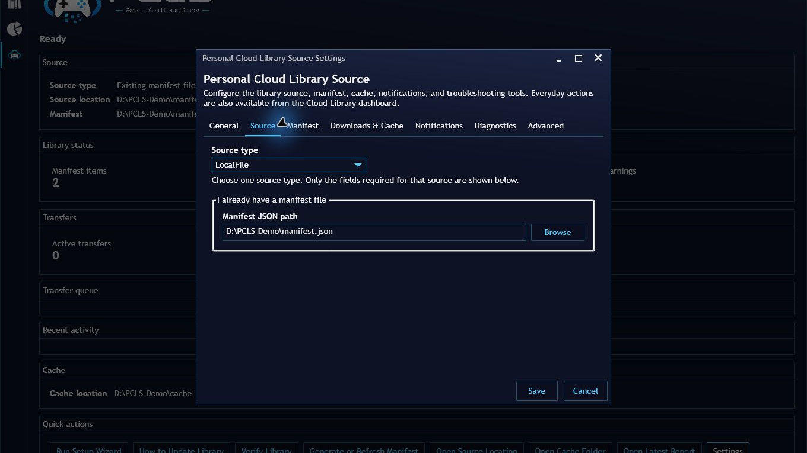

# Rclone Setup



Personal Cloud Library Source uses rclone as a generic provider for cloud storage. This is how Google Drive, OneDrive, Dropbox, and many other storage providers are supported.

Rclone is optional and only needed for rclone remote scanning or `RcloneRemote` provider mode. Local folders, external drives, mapped drives, and NAS paths do not require rclone.

Configure rclone outside Playnite first. The plugin calls the existing rclone setup; it does not configure cloud accounts itself.

> **Unreleased stabilization branch:** the standalone generator adds `-TimeoutSeconds` (default 300, range 5–3600), bounded listings and atomic per-file output replacement. `-Overwrite` retains a unique sibling backup of a replaced catalog/report; without it, existing outputs are refused. These changes are not part of the published v0.3.2 package.

## Install Rclone

Install rclone from the official rclone project and confirm it runs:

```powershell
rclone version
```

If `rclone` is not on `PATH`, set `RcloneExecutablePath` in the plugin to the full `rclone.exe` path.

> **Unreleased stabilization candidate:** production transfer, manifest and connection-test execution use a native Windows Job Object assigned at launch. Use a supported Windows host and a fully qualified executable path or an absolute PATH entry. If containment cannot be established, the operation refuses rather than falling back to an uncontained process. A failed or cancelled directory download with remaining staging content is retained for Review Transfer Recovery instead of automatically deleted. Do not remove pending records to force a retry. The branch adds a separate, digest-pinned local-only rclone CI gate; native Playnite host acceptance remains required. These changes are not part of published v0.3.2.

## Create a Remote

Run:

```powershell
rclone config
```

Create a remote for the provider you use, such as Google Drive, OneDrive, Dropbox, or another rclone-supported provider.

Example remote names:

```text
google_drive
onedrive
dropbox
```

List configured remotes:

```powershell
rclone listremotes
```

## Test Manifest Access

Use your remote name and manifest path:

```powershell
rclone cat remote:PersonalLibrary/manifest.json
```

The command should print valid JSON.

You can also test any path shape you plan to use:

```powershell
rclone cat remote:path/to/manifest.json
```

## Plugin Settings Mapping

```text
SourceProviderType = RcloneRemote
RcloneExecutablePath = rclone
RcloneRemoteName = remote
RcloneManifestPath = PersonalLibrary/manifest.json
RcloneContentRoot = PersonalLibrary/files
RcloneTimeoutSeconds = 90
LocalCacheFolder = D:\PersonalCloudLibraryCache
AllowDownloads = true
```

For Google Drive or OneDrive, use the remote name you created in `rclone config`.

The provider settings screen maps directly to these rclone values: executable path, remote name, manifest path, optional content root, and timeout.

`RcloneTimeoutSeconds` defaults to 90 seconds and accepts values from 5 to 300 seconds. Its meaning depends on the operation:

- `rclone cat` manifest reads and `rclone listremotes` connection tests use the configured value as a total `WaitForExit` deadline. They do not extend the deadline when output arrives.
- Queued transfers must produce first output or error activity within at most 30 seconds (`min(30, configured timeout)`). After first activity, the configured value is the inactivity deadline between output or error lines. The default is therefore a 90-second inactivity deadline, not a total queued-transfer deadline, and an active transfer may run longer.

`RcloneRemote` reads manifests with `rclone cat`.

Downloads use:

- `rclone copyto` for `sourceType = file`
- `rclone copy` for `sourceType = directory`

## Generate a Manifest from an Rclone Remote

```powershell
.\tools\generate-manifest.ps1 `
  -RcloneRemoteRoot "gdrive:PersonalLibrary" `
  -OutputPath ".\personal-cloud-library.generated.json" `
  -Overwrite
```

You can also keep using the thin compatibility wrapper:

```powershell
.\tools\generate-rclone-manifest.ps1 `
  -RcloneRemoteRoot "gdrive:PersonalLibrary" `
  -OutputPath ".\personal-cloud-library.generated.json" `
  -Overwrite
```

## Avoid Doubled Content Paths

If `RcloneContentRoot` is set, item `sourcePath` values should be relative to that root.

Correct:

```text
RcloneContentRoot = PersonalLibrary/files
sourcePath = Game/Game.exe
```

Incorrect:

```text
RcloneContentRoot = PersonalLibrary/files
sourcePath = PersonalLibrary/files/Game/Game.exe
```

The incorrect example resolves to:

```text
PersonalLibrary/files/PersonalLibrary/files/Game/Game.exe
```

The manifest validation button warns when it sees this likely path-doubling mistake. If `RcloneContentRoot` already points at `PersonalLibrary/files`, item `sourcePath` values should start below that point, not repeat it.
