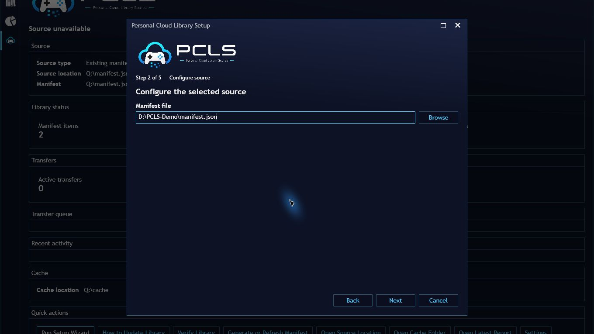

# Setup Wizard Flow

The setup wizard is a Playnite Desktop management surface. Fullscreen users should complete setup in Desktop before using imported games.

## Dedicated wizard versus advanced settings

The five-step Desktop wizard now has a **read-only game preview**. For LocalFolder, external-drive, and NAS sources, the preview uses the same detection logic as manifest generation, scans at most 10,000 entries, and displays detected titles, skipped entries, and warnings without writing any files. For LocalFile sources it previews validated JSON entries. The preview can be stopped or retried and runs off the UI thread. Cloud/rclone setups show explicit connection guidance rather than pretending to inspect a remote.

The scan is **not** an import: completing the wizard generates a local-folder catalog when needed, saves settings, and opens the dashboard. Then run **Verify setup / generate report** in settings and **Update Game Library** using Playnite's own menu to import the games. Preview errors do not silently fabricate a catalog; the full generation still runs at Finish and can report errors.

Cloud/rclone mode requires an installed, configured rclone remote first. A normal synced folder or NAS share does not require rclone.

## Goal

A normal Playnite user should be able to:

1. Open **Extension settings -> Libraries -> Personal Cloud Library Source**
2. Choose a source mode
3. Generate or select a manifest
4. Verify the setup and generate a verification report
5. Run **Update Game Library**

## Local Folder or NAS Flow

1. Choose `LocalFolder`.
2. Browse to the local library root.
3. Review the bounded, read-only game preview (up to 10,000 scanned entries). Use **Scan again** or **Stop scan** as needed.
4. Finish the wizard to generate the actual manifest, then review its item count, skipped count, and generated report.
5. Run **Verify setup / generate report**.
6. Review the verification report if anything looks wrong.
7. Save settings.
8. Run **Update Game Library**.

The generated manifest is stored under the plugin user data path, not under the extension install folder.

## Local JSON Manifest Flow

1. Choose `LocalFile`.
2. Browse to a manifest JSON file.
3. Review the validated entries in the read-only preview, then choose a local cache folder.
4. Click **Verify setup / generate report** after finishing the wizard.
5. Review the verification report if setup needs attention.
6. Save settings.
7. Run **Update Game Library**.

## Rclone Flow

1. Choose `RcloneRemote`.
2. Set the rclone executable path if `rclone` is not on `PATH`.
3. Enter the remote name.
4. Enter the manifest path inside the remote.
5. Enter `RcloneContentRoot` only if item `sourcePath` values should resolve beneath a remote subfolder.
6. Click **Test rclone connection**.
7. Click **Verify setup / generate report**.
8. Review the report for path-doubling or manifest-load issues.
9. Save settings.
10. Run **Update Game Library**.

## Report Locations

The guided setup flow writes reports to the plugin user data path:

- generated manifest files under `manifests`
- verification reports under `reports`
- import diagnostics under `diagnostics`

The plugin can also create lightweight backups of generated outputs under `backups`.

## Current boundary

In-Playnite manifest generation is available for local and NAS-style filesystem sources.

Advanced rclone-based manifest generation can still use:

- `tools/generate-manifest.ps1`
- `tools/generate-rclone-manifest.ps1`

The dedicated wizard and dashboard are not available in Fullscreen. Standard imported-game play, install, and uninstall controllers do not depend on those windows, but installed Fullscreen qualification is still pending.
