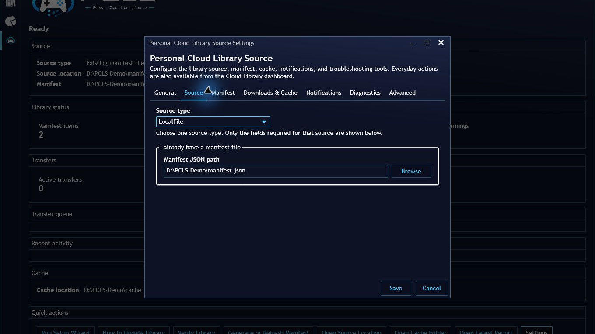
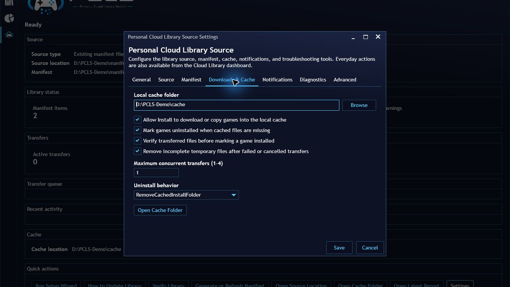
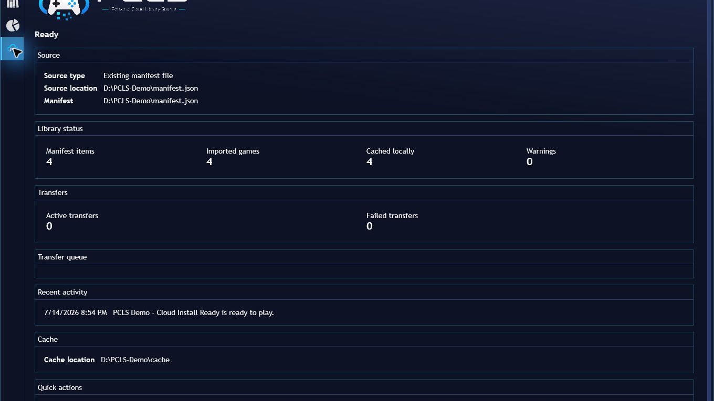

# Troubleshooting


Use diagnostics and the settings screen first when troubleshooting provider paths, cache state, or uninstall behavior.

The fastest first step is now **Verify setup / generate report**, then open the latest verification report from the settings screen.



Provider settings control where the manifest is read from.



Cache and uninstall settings control where files are copied/downloaded and what cached files may be removed.

The dashboard shows current source health and recent transfer results without requiring the settings window.



## I Expected Streaming

Personal Cloud Library Source is not a game-streaming service and does not stream gameplay. It catalogs entries, downloads or copies selected items into a local cache, and launches cached files locally through Playnite.

## rclone is not recognized

Set `RcloneExecutablePath` to the full path of `rclone.exe`, or add rclone to `PATH`.

This only matters for `RcloneRemote` mode or rclone-based manifest generation. Local filesystem generation and LocalFolder use do not require rclone.

## Remote manifest path is wrong

Test outside Playnite:

```powershell
rclone cat remote:PersonalLibrary/manifest.json
```

If this fails, update `RcloneRemoteName` or `RcloneManifestPath`.

## JSON BOM or Encoding Issue

Save the manifest as valid UTF-8 JSON. The importer trims a leading UTF-8 BOM, but malformed JSON will fail to load.

The verification report records whether manifest loading succeeded and captures the failure message without dumping the full manifest.

## Generated Manifest Is Empty

Check that the source root actually contains supported launchable files or supported directory packages.

Common reasons for an empty generated manifest:

- the source root only contains ignored metadata, artwork, save, or media files
- files are under excluded folders
- only unsupported extensions were found
- the selected root is one level too high or one level too low

Run the generator with `-DryRun` first if you want to inspect what it detects without writing files.

The generated manifest report and verification report are both useful here:

- the generated manifest report explains what was skipped during the scan
- the verification report summarizes whether the resulting manifest is usable in the current provider mode

## Cloud Item Appears Uninstalled

This is expected when the cached launch file is missing and `TreatMissingFilesAsUninstalled` is enabled. Use `Download to local cache` if the item has a resolvable `sourcePath`.

## Game Appears but Is Uninstalled

The entry exists in Playnite, but the expected local cached launch file does not exist yet. This is normal for cloud-only items. Download or copy it to the local cache when you are ready to launch it.

## Metadata Before Download

Imported entries behave like normal Playnite entries even before the files are cached. You can use Playnite's metadata tools to add covers, descriptions, genres, screenshots, and other metadata first.

## Playnite Filters Hide Uninstalled Games

If diagnostics show the item was returned but Playnite does not show it, check filters and make sure uninstalled games are visible.

## Download Action Not Visible

Confirm:

- `AllowDownloads` is enabled.
- The item has `sourcePath` or legacy `remotePath`.
- The local cached launch file is missing.
- The provider can resolve the source path.
- The game belongs to this plugin.

## External LocalFile sources (internal stabilization candidate)

Absolute and UNC source paths remain supported. The configured local library root, or the manifest directory when no root is configured, is the selected source boundary. An item outside that boundary is a lexical candidate, not proof of file availability. The candidate prompts before external download, source navigation or ZIP inspection; access to a network share can authenticate to its server. Approve only a path you recognize and trust. Declining does not queue an install or inspect the external file. A configured UNC library can operate without an extra per-item prompt. These are consent guards, not a filesystem sandbox; use trusted manifests and configured roots.

## Interrupted transfer or recovery reservation (internal stabilization candidate)

Open **Review Transfer Recovery** in the plugin menu. The review shows recorded destinations and staging paths, marker origin, unreadable records and current-session job IDs whose reservations could not be reconciled. Missing markers or an empty list do not by themselves establish safe recovery.

1. Stop new downloads and request cancellation of any known active job through the normal transfer UI.
2. Record the job ID and recovery screen; close Playnite normally and establish whether related transfers/processes have stopped. If unsure, preserve all evidence and seek assistance.
3. Preserve the source, existing cached destination, any partial staging, and the complete plugin user-data recovery journal. Copy evidence to a separate safe backup location after activity has stopped, without moving or deleting the original.
4. Do not edit or remove `.pending` markers or rename/delete staging to force a retry. A valid marker may belong to another instance; an unreadable marker may protect an ambiguous transfer. The current candidate deliberately does not provide restart release or automatic cleanup of uncertain evidence.
5. Report whether destination and staging exist, the exact candidate revision and the observed error. Redact private paths or credentials when sharing diagnostics.

This procedure preserves evidence; it does not clear a reservation. Support-assisted recovery and a validated operator release protocol are still outstanding.

The internal candidate defers a whole-library refresh and hosted file-only uninstall while a transfer is active, a pending journal marker exists, or recovery state cannot be verified. This is intentional even for unrelated games: it preserves the previous catalog rather than promote an uncertain cached destination or allow removal during transfer. Once ordinary active transfers finish and their reservations are cleanly released, retry the refresh or removal. A retained or unreadable reservation requires review; never delete a marker just to unblock the interface. The refresh notification opens the recovery review. These checks are not an interprocess transaction with Playnite or other filesystem writers.

Existing Play actions are also checked before startup. A related active or retained transfer reservation, overlapping absolute launch/install path, or active same-game ZIP operation defers launch. Valid unrelated reservations need not block unrelated games; unreadable or unverified reservation evidence may block launch. Open **Review Transfer Recovery** rather than editing a pending marker or trying to bypass the startup guard. These checks do not resolve every custom relative launch path or serialize arbitrary external game launches.

## Difference between Remove and Uninstall

`Remove cached copy` and Playnite uninstall target eligible local cached files. Recursive folder removal is disabled in the internal candidate; source provider files, manifests and rclone remote content must remain untouched.

## sourceType=directory Item Imports but Is Not Playable

Some directory packages intentionally leave `launchFile` blank, especially Wii U-style `code/content/meta` packages.

This is normal for package-style content that does not have a direct single launch file. If you need a direct launch target, use a manifest item whose copied directory contains a detectable launch file such as `.cue`, `.m3u`, `.chd`, `.iso`, `.exe`, `.bat`, `.cmd`, or `.lnk`.

## Rclone Path Looks Doubled

If `RcloneContentRoot` is set to `PersonalLibrary/files`, item `sourcePath` values should not also start with `PersonalLibrary/files`.

Correct:

```text
RcloneContentRoot = PersonalLibrary/files
sourcePath = Game/Game.exe
```

Incorrect:

```text
RcloneContentRoot = PersonalLibrary/files
sourcePath = PersonalLibrary/files/Game/Game.exe
```

The incorrect setup resolves to `PersonalLibrary/files/PersonalLibrary/files/Game/Game.exe`. Use the manifest validation button to catch this warning.

The verification report includes a dedicated count for these warnings.

## .bin Sidecar Files Should Not Appear as Separate Entries

Standalone `.bin` files are intentionally skipped by the manifest generator. Disc packages should appear as one directory item that uses the matching `.cue`, `.m3u`, `.chd`, `.pbp`, `.iso`, or launcher file.

If you see a loose `.bin` in a generated manifest, regenerate with the current `tools/generate-manifest.ps1`.

## Metadata or Package Folders Were Skipped

The generator skips non-launchable metadata and support folders such as saves, screenshots, artwork caches, and similar support content. It also treats some legacy folder names as compatibility excludes.

This behavior is intentional so the manifest stays focused on launchable files and package directories.

## Uninstall Did Not Delete Files

In the internal stabilization candidate, file-only uninstall requires a verified ordinary eligible cache file. Recursive folder removal remains disabled, regardless of legacy folder-removal or ask-each-time settings. Preserve managed ZIP content for the dedicated maintenance/recovery workflow. Do not manually remove a folder simply because the uninstall action was refused.

## Uninstall Refused Because Path Is Outside Cache

By default, uninstall is only allowed for paths inside `LocalCacheFolder`. This prevents accidental deletion of source-provider files or unrelated local files.

Do not enable outside-cache removal to work around a refusal. Use a valid managed cache configuration. The internal multi-source candidate does not permit outside-cache uninstall.

## Game Still Appears After Uninstall

This is expected. Uninstall removes the cached local copy only. The manifest record remains, Playnite metadata can remain, and the entry should appear as uninstalled after a library update.

## File Launches but Command Window Closes

This is normal for short test `.bat` files. Add a `pause` line to your own test launcher if you need to inspect the output.

## Diagnostics Location

When `EnableDiagnostics` is enabled, diagnostics are written to:

```text
<Playnite plugin user data>\diagnostics\last-import-diagnostics.txt
```

Fallback path:

```text
%LOCALAPPDATA%\PersonalCloudLibrarySource\diagnostics\last-import-diagnostics.txt
```

## Verification Report Location

Verification reports are written to:

```text
<Playnite plugin user data>\reports\latest-verification-report.txt
```

The report is intentionally capped and summarized for privacy. It does not print the entire manifest inventory by default.

## Backups for Plugin-Generated Outputs

When the plugin replaces its own generated manifest or verification report files, it can create lightweight backups under:

```text
<Playnite plugin user data>\backups\
```

These backups apply to plugin-generated outputs only. They do not touch source/cloud files or personal game content.
